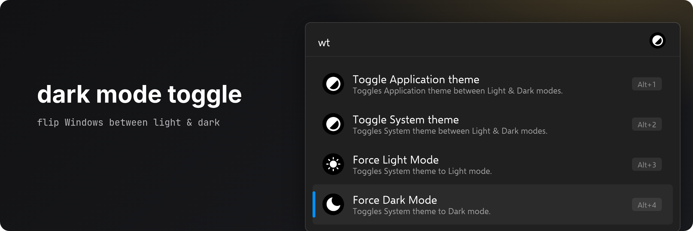

<!-- generated by readwright from docs/README.md.j2; edit the template, not this file -->


# Windows Dark Mode Toggle

Switch Windows between dark and light mode from Flow Launcher.

[](https://github.com/Garulf/windows-dark-mode-toggle/actions/workflows/tests.yml) [](https://github.com/Garulf/windows-dark-mode-toggle/releases/latest) [](https://github.com/Garulf/windows-dark-mode-toggle/releases/latest)

[](https://www.buymeacoffee.com/garulf) [](https://github.com/sponsors/Garulf)

## Features

* **One keystroke.** `wt` then `Enter` flips both the system and app theme.
* **Apps or system only.** Toggle just the app theme or just the taskbar and Start menu theme.
* **Force a mode.** Go straight to light or dark, whatever the current state.

## Usage

Type `wt` and press `Enter`. If either the system or the app theme is light, both switch to dark.
If both are dark, both switch to light.


### Context menu

Open the context menu (`Shift+Enter` or right-click) on the result for more control:


| Action | What it does |
| --- | --- |
| Toggle Application theme | Flips only the app theme |
| Toggle System theme | Flips only the system theme (taskbar, Start menu) |
| Force Light Mode | Sets both themes to light |
| Force Dark Mode | Sets both themes to dark |

The plugin writes `SystemUsesLightTheme` and `AppsUseLightTheme` under
`HKEY_CURRENT_USER\Software\Microsoft\Windows\CurrentVersion\Themes\Personalize`, the same
values the Windows Settings app uses.

## Installation

### Flow Launcher

In Flow Launcher, type:

```
pm install Windows Dark Mode Toggle
```


### Manual installation

Download `windows-dark-mode-toggle-<version>.zip` from the [latest release](https://github.com/Garulf/windows-dark-mode-toggle/releases/latest) and unzip it into
`%appdata%\FlowLauncher\Plugins`, then restart Flow Launcher.

Pre-releases of the next version are published from the open release PR on the
[releases page](https://github.com/Garulf/windows-dark-mode-toggle/releases) for testing. Flow Launcher won't offer them as updates.

## Requirements

* Windows 10 or 11
* Flow Launcher 1.17.0 or newer
* Python 3.8 or newer, which Flow Launcher can install for you

## Changelog

See [CHANGELOG.md](CHANGELOG.md) for the full history.
